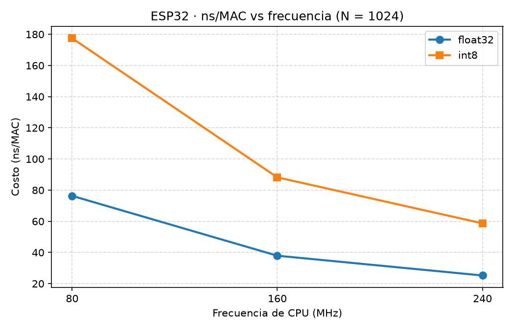

# Práctica 1 · Plataforma y toolchain

**Curso:** AIASE · Grupo **7BM1** · Equipo 1

## 1. Integrantes y rol

Trabajo repartido en paralelo; cada quien aportó en laboratorio y en el repositorio.

| Integrante | Boleta | Responsabilidades principales |
|------------|--------|-------------------------------|
| **Cervantes Gómez David Joacim** | 2024630229 | Montaje (placa, LED/GPIO 2, cable USB), evidencia fotográfica y video del superlazo, conteo del periodo del LED (~10 s) para la Tabla 6. |
| **García Jiménez Alan** | 2024630325 | Carga y corrida de Listados 1–3 en la placa, captura del Monitor Serie (plataforma, iter/s a/b/c), registro inicial de Tablas 4 y 6, apoyo en el benchmark MAC (cambios de N y revisión de salidas). |
| **Sandoval Vásquez, Gonzalo** | 2024630527 | Toolchain en macOS (IDE, núcleo 3.3.12, drivers), organización de `firmware/` / `datos/` / `evidencias/`, mediciones con `xtensa-esp32-elf-size -A` (Tabla 5), script y gráfica ns/MAC, consolidación de tablas, cuestionario y redacción del README. |

## 2. Objetivo

Configurar el toolchain del ESP32, cargar firmware, interpretar uso de memoria y rendimiento (superlazo y MAC float32/int8) como presupuesto para IA en el borde; dejar operativa la SBC (Raspberry) para comparar ns/MAC (pendiente de hardware).

## 3. Plataforma y conexiones

- **Placa:** NodeMCU / DevKit ESP32 (CP210x), chip ESP32-D0WD-V3 v3.1  
- **Núcleo:** Arduino-ESP32 3.3.12 / ESP-IDF v5.5.5  
- **Puerto:** `/dev/cu.usbserial-0001`  
- **LED:** GPIO 2 (externo o de usuario), periodo nominal 500 ms (2 Hz)  
- **Foto:** [`evidencias/foto_placa.jpg`](evidencias/foto_placa.jpg)

## 4. Desarrollo, decisiones y problemas

- Se usó Arduino IDE 2 con salida verbose para localizar el `.elf` y correr `xtensa-esp32-elf-size -A` (ruta completa bajo `Arduino15/.../esp-x32/...`, no solo el nombre del binario).  
- Listado 2: tres compilaciones (a/b/c) del arreglo de 16 KiB; el hash de caché del sketch cambia si el archivo no está guardado.  
- Superlazo: TODOs del PDF completados (impresión a 1 Hz; `delay(1)` y `Serial.printf("x")` medidos y dejados comentados).  
- Video del iPhone (~603 MB 4K) se re-encodeó a 720p (~5 MB) para caber en GitHub.  
- **Parte D (Raspberry):** no ejecutada por falta de SBC en el equipo.

Códigos de entrega: carpeta [`firmware/`](firmware/) (un sketch por carpeta). Script SBC: [`sbc/p01_benchmark_sbc.py`](sbc/p01_benchmark_sbc.py). Datos crudos: [`datos/`](datos/).

## 5. Resultados

Detalle ampliado también en [`datos/tablas_resultados.md`](datos/tablas_resultados.md).

### Tabla 4. Datos de la plataforma

| Dato | Reportado por el firmware | Hoja de datos (típico) | ¿Coincide? |
|------|---------------------------|-------------------------|------------|
| Modelo y revisión del chip | ESP32-D0WD-V3 v3.1 | ESP32-D0WD-V3 (rev. 3) | Sí |
| Núcleos y frecuencia de CPU | 2 núcleos, 240 MHz | 2 × Xtensa LX6, hasta 240 MHz | Sí |
| Tamaño de la flash | 4 194 304 bytes (4 MB) | Flash externa típica 4 MB | Sí |
| Heap total, libre y bloque máximo | 377 696; 331 676 libre; máx. 110 580 | SRAM ~520 KB; heap depende del firmware | Coherente |
| PSRAM | 0 bytes | Esta placa no trae PSRAM | Sí |
| Firmware y partición OTA siguiente | 274 304 bytes; OTA 1 310 720 | Esquema default ~1.25 MB/app | Sí |
| Versión del núcleo / ESP-IDF | 3.3.12 / v5.5.5 | — | — |
| MAC de Wi-Fi (estación) | C8:85:41:E3:70:5C | Única por módulo | — |

### Tabla 5. Uso de memoria (bytes)

| Compilación | Programa (IDE) | Memoria dinámica (IDE) | .flash.text | .flash.rodata | .dram0.data | .dram0.bss |
|-------------|----------------|------------------------|-------------|---------------|-------------|------------|
| Listado 1 (base) | 274 152 (≈20%) | 22 236 (≈6%) | 136 024 | 54 072 | 16 961 | 5 272 |
| Listado 2 (a) con const | 285 616 (21%) | 22 116 (6%) | 133 320 | 68 568 | 16 849 | 5 264 |
| Listado 2 (b) sin const | 285 616 (21%) | 38 500 (11%) | 133 320 | 52 184 | 33 233 | 5 264 |
| Listado 2 (c) sin inicializar | 269 232 (20%) | 38 500 (11%) | 133 320 | 52 184 | 16 849 | 21 648 |

### Tabla 6. Superlazo

| Condición | Periodo LED medido (ms) | Error frente a 500 ms (%) | Iteraciones del lazo / s |
|-----------|-------------------------|---------------------------|--------------------------|
| (a) Listado 3 tal cual | 500 (20 ciclos / 10 s de video) | 0 % | ≈ 765 965 |
| (b) con `delay(1)` | ~500 (mismo `T_LED_MS`; no se recontó en video) | ~0 % | ≈ 1 000 |
| (c) con `Serial.printf` por iteración | No medido en video: el Monitor se satura de `x` y no se pudo contar ciclos con la misma claridad que en (a) | No aplica (sin conteo fiable) | ≈ 11 573 |

**Diferencias:** en (a) el lazo va a toda velocidad y el LED cumple 500 ms. En (b) `delay(1)` duerme ~1 ms por vuelta → cae a ~1000 iter/s, pero el LED sigue la misma rejilla de 250 ms por flanco. En (c) imprimir en cada iteración satura el UART (115200): el throughput cae a ~11.5k iter/s y la evidencia visual del LED deja de ser usable para un conteo limpio; por eso el periodo/error de (c) no se rellenan con un número inventado.

### Tabla 7. Costo de la MAC en el ESP32

| Configuración | float32 (ns/MAC) | float32 (ciclos/MAC) | int8 (ns/MAC) | int8 (ciclos/MAC) |
|---------------|------------------|----------------------|---------------|-------------------|
| 240 MHz, N = 1024 | 25.23 | 6.05 | 58.68 | 14.08 |
| 160 MHz, N = 1024 | 37.92 | 6.07 | 88.20 | 14.11 |
| 80 MHz, N = 1024 | 76.32 | 6.11 | 177.46 | 14.20 |
| 240 MHz, N = 256 | 25.60 | 6.14 | 59.03 | 14.17 |
| 240 MHz, N = 4096 | 25.13 | 6.03 | 58.59 | 14.06 |

**Estimación Parte C · punto 3** — capa densa 1024×64 = **65 536 MAC**, usando 240 MHz y N=1024:

| Tipo | Cálculo | Tiempo estimado |
|------|---------|-----------------|
| float32 | 65 536 × 25.23 ns | **≈ 1.65 ms** |
| int8 | 65 536 × 58.68 ns | **≈ 3.85 ms** |

### Tabla 8. Datos y rendimiento de la SBC

| Dato | Valor |
|------|-------|
| Modelo (`/proc/device-tree/model`) | **No medido:** aún no se dispone de Raspberry Pi en el equipo |
| Arquitectura (`uname -m`) y núcleos (`nproc`) | **No medido:** falta SBC |
| RAM total y disponible | **No medido:** falta SBC |
| Espacio libre en la microSD | **No medido:** falta SBC |
| Temperatura en reposo | **No medido:** falta SBC |
| Dirección IP | **No medido:** falta SBC |
| Python puro (ns/MAC) | **No medido:** falta SBC |
| NumPy float32 (ns/MAC) | **No medido:** falta SBC |
| NumPy int8 → int32 (ns/MAC) | **No medido:** falta SBC |
| ESP32 float32 a 240 MHz (ns/MAC, Tabla 7) | **25.23** (sí medido en ESP32) |

### Gráfica obligatoria

Script: [`datos/grafica_ns_mac.py`](datos/grafica_ns_mac.py).

### Evidencias

| Archivo | Contenido |
|---------|-----------|
| [`evidencias/foto_placa.jpg`](evidencias/foto_placa.jpg) | Placa / montaje |
| [`evidencias/monitor_ide.png`](evidencias/monitor_ide.png) | Monitor con `iter/s` |
| [`evidencias/video_led_monitor.mp4`](evidencias/video_led_monitor.mp4) | LED + monitor (~60 s) |
| [`evidencias/grafica_ns_mac_vs_mhz.png`](evidencias/grafica_ns_mac_vs_mhz.png) | ns/MAC vs MHz |

## 6. Análisis y cuestionario (PDF §8)

### 1. ISA ESP32 vs Raspberry Pi

ESP32-D0WD-V3: ISA **Xtensa LX6**. Raspberry Pi 4/5: **ARM** (AArch64). Ambas son **RISC** (instrucciones simples, load/store). Compilar en la Mac para Xtensa es **cross-compilación**: el binario no corre en la Mac, solo en el ESP32.

### 2. Dónde quedó `pesos` (Tabla 5)

| Caso | Sección | Por qué |
|------|---------|---------|
| (a) `const` | `.flash.rodata` | solo lectura → flash; poca RAM |
| (b) sin `const`, init | `.dram0.data` | RAM + copia de iniciales en flash |
| (c) sin init | `.dram0.bss` | solo RAM; programa más chico |

**Regla:** pesos del modelo → `const` en flash.

### 3. `tLed += T_LED_MS` y desbordamiento de `millis()`

`tLed = ahora` acumula retraso si el lazo llega tarde; `+=` mantiene la rejilla de 500 ms. Con `uint32_t`, `ahora - t0 >= T` sigue correcto tras el wrap de `millis()`; `ahora >= t0 + T` no (la suma puede desbordar). Ejemplo: `t0 = 0xFFFFFFF0`, `T = 32`, `ahora = 0x00000010` → `ahora - t0 = 32` correcto.

### 4. ¿ns/MAC ∝ 1/frecuencia?

Sí en tiempo (76.32 → 37.92 → 25.23 ns al subir MHz). Los **ciclos/MAC** (~6 float, ~14 int8) casi no cambian: el trabajo en ciclos es constante.

### 5. ¿int8 más rápido que float32?

**No** aquí: 58.68 vs 25.23 ns/MAC a 240 MHz. El chip tiene **FPU**; int8 es software. Ventaja de int8: **~4× menos memoria** de pesos.

### 6. Modelo 300 KB + arena 120 KB

Firmware ~274 KB + pesos 300 KB en flash caben en la app (máx. 1 310 720). Arena 120 KB: no cabe limpia como `.bss` (tope globals ~124.5 KB con base ~22 KB) ni como un solo bloque de heap (máx. 110 580). Modelo de 40 MB: no cabe (flash 4 MB).

### 7. ESP32 vs Python/NumPy en la SBC

**No respondida con números propios:** falta ejecutar Listado 6 en Raspberry. Referencia ESP32 float32 @ 240 MHz = **25.23 ns/MAC**. Se completará con Tabla 8.

### 8. Bootloader de 2ª etapa y particiones

El ROM carga el bootloader de 2ª etapa; este lee la tabla de particiones y salta a la app. El tamaño máximo del firmware lo limita la partición **app** (default 1 310 720 B). Si no cupiera el modelo: esquema `huge_app`, FS en flash, o pesos externos — 40 MB no caben en 4 MB.

## 7. Conclusiones individuales

**Cervantes Gómez, David Joacim:** Montar y verificar el LED a 2 Hz obliga a mirar el hardware de cerca: el periodo medido en video (500 ms) coincidió con el diseño del superlazo. Queda pendiente repetir el mismo rigor de evidencia cuando tengamos la Raspberry (Parte D).

**García Jiménez, Alan:** Comparar el lazo “limpio” con `delay(1)` y con `Serial` por iteración muestra que el cuello de botella no siempre es la CPU: a veces es el propio firmware o el UART. Las tablas de plataforma y superlazo dejan un piso claro para las prácticas de sensores/actuadores.

**Sandoval Vásquez, Gonzalo:** Además del trabajo en placa del equipo, al cerrar memoria (`size`), MAC y el reporte se ve el presupuesto real: `const` vs RAM, float32 con FPU frente a int8 en software, y una capa 1024×64 en ~1.65 ms (float) / ~3.85 ms (int8). Falta la comparación con la SBC para completar el cuestionario (pregunta 7) y la Tabla 8.

## 8. Uso de IA

- **Herramienta:** ChatGPT (versión web, uso puntual).  
- **Para qué:** comprobar dudas sueltas (p. ej. si la resta `ahora - t0` con `uint32_t` cubre el desbordamiento de `millis()`, y la fórmula de ns/MAC × 65 536 para la capa densa). No se usó para generar el firmware ni las mediciones.  
- **Qué hicimos nosotros:** instalación del toolchain, armado, carga de listados, lecturas del Monitor, `size -A`, conteo del LED, tablas, gráfica, evidencias y redacción del reporte. Las salidas en `datos/` y las capturas en `evidencias/` son del equipo.

## 9. Referencias

1. PDF del curso: `archivos_practicas/AISE_7BM1_Practica_01_Plataforma_Toolchain.pdf`  
2. Espressif, Arduino-ESP32 3.3.x / ESP-IDF v5.5.5  
3. Documentación `millis()` / aritmética sin signo (Arduino / AVR-ESP32 core)
